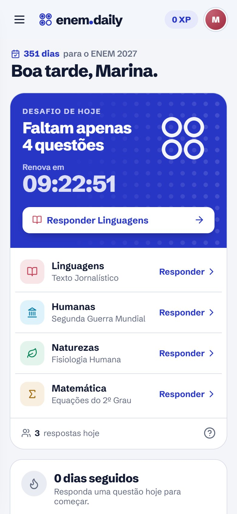
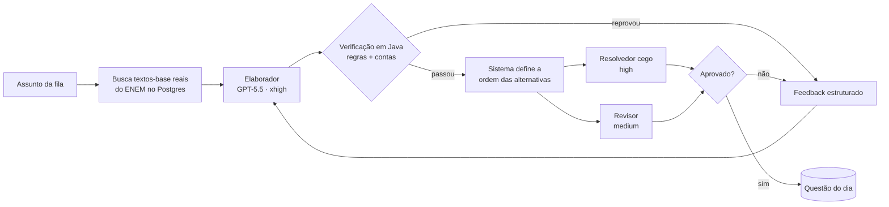
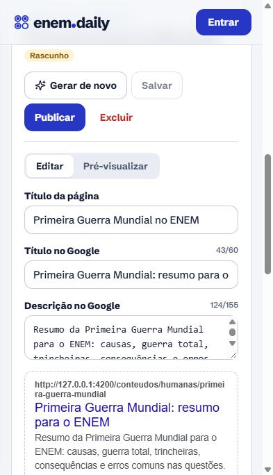
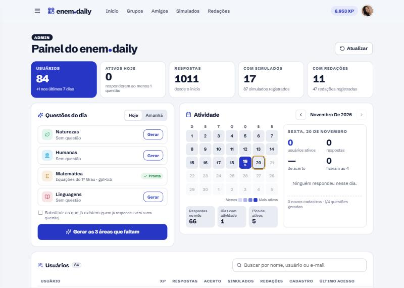

  <picture>
    <source media="(prefers-color-scheme: dark)" srcset="docs/readme/logo-escuro.png">
    
  </picture>

  <b>Desafio diário com 4 questões inéditas no padrão ENEM, geradas e revisadas por IA.</b>

  
  
  
  
  
  

## Sumário

- [Visão geral](#visão-geral)
- [Geração de questões com IA](#geração-de-questões-com-ia)
  - [Resumo do pipeline](#resumo-do-pipeline)
  - [Modelo e esforço de raciocínio](#1-modelo-e-esforço-de-raciocínio)
  - [Saída estruturada com JSON Schema](#2-saída-estruturada-com-json-schema)
  - [Engenharia de prompt](#3-engenharia-de-prompt)
  - [Exemplos reais como referência](#4-exemplos-reais-como-referência)
  - [Resolvedor cego e revisor](#5-resolvedor-cego-e-revisor)
  - [Loop de revisão](#6-loop-de-revisão)
  - [Verificações determinísticas](#7-verificações-determinísticas)
  - [Robustez e custo](#8-robustez-e-custo)
  - [Conteúdo de estudo com revisão humana](#9-conteúdo-de-estudo-com-revisão-humana)
- [Backend](#backend)
- [Frontend](#frontend)
- [Como rodar](#como-rodar)

---

## Visão geral

- **4 questões por dia**, uma de cada área do ENEM: Linguagens, Ciências Humanas, Ciências da Natureza e Matemática.
- **Questões inéditas**, geradas por IA com base em 3.000 questões disponibilizadas pelo INEP como contexto e aprovadas por um pipeline de revisão automática.
- **Formato oficial:** texto-base, comando e 5 alternativas, com 3min30 por questão.
- **XP por acerto** (quanto mais rápido, mais XP) e sequência de dias.
- **Uma animação de campus universitário que evolui a cada acerto seu**, com estruturas especiais liberadas por metas.
- **Social:** grupos com ranking, duelos diários entre amigos e resumo do dia compartilhável.

  
  
  

  
  

---

## Geração de questões com IA

### Resumo do pipeline

Em janeiro de 2026, durante o início da minha implementação, utilizava uma única chamada ao modelo de LLM para geração das questões, causando alucinações, erros de raciocínio e estruturação das questões. Por isso, depois de meses finalizei uma estrutura satisfatória para a geração das questões e segue o mesmo fluxo de uma banca de elaboração:

1. **Busca:** o sistema possui um banco com mais de 2.000 questões exemplo de provas antigas do ENEM. De acordo com o assunto sorteado para o dia, o sistema busca questões (com full-text search) que possam servir de exemplo no contexto para a IA.
2. **Elaborar:** nesta chamada, a IA escreve a questão com base na Matriz de Referência do INEP para a área e nas questões exemplo encontradas no banco, caso hajam.
3. **Resolver às cegas:** outra chamada para a IA resolve a questão sem conhecer o gabarito.
4. **Revisar:** outra chamada  avalia a questão com uma rubrica de 11 critérios para definir o nível de confiabilidade da questão.
5. **Corrigir ou publicar:** se alguma etapa reprovar, o item volta ao elaborador com todos os apontamentos. Se tudo passar, vira a questão do dia.

### 1. Modelo e esforço de raciocínio

O modelo é o **GPT-5.5**, acessado pela **Responses API**. O cliente HTTP é próprio, feito com `java.net.http`, para ter controle total dos parâmetros. Cada etapa usa um nível de *raciocínio*, configurável por propriedade:

| Etapa | Esforço | Motivo |
|---|---|---|
| Elaborar | `xhigh` | Define a qualidade do item: contas consistentes, distratores plausíveis e texto-base necessário. |
| Resolver às cegas | `high` | Precisa encontrar dupla resposta e erro de cálculo, com saída curta. |
| Revisar | `medium` | Avalia estilo e homogeneidade; a parte crítica já é coberta pelo Java e pelo resolvedor. |

Os níveis foram escolhidos por medição. Com esforço baixo, o item reprovava com mais frequência e as rodadas extras de revisão anulavam a economia. Na configuração atual, **uma questão aprovada custa cerca de US$ 0,40**.

### 2. Saída estruturada com JSON Schema

Todas as etapas usam **Structured Outputs com `strict: true`**. A resposta sempre respeita o schema e é desserializada direto em `record`s Java, sem parsing frágil de texto.

Isso é fundamental tanto para o fluxo da geração quanto para a estrutura das questões:
- A questão é estruturada em texto base, enunciado, alternativas, gabarito, explicação geral, assunto e explicação de cada alternativa.
- O fluxo utiliza métricas como nível de confiabilidade (avaliada pelo chamada de revisão), sugestões de correção e ordens de volta ao elaborador.

### 3. Engenharia de prompt

O prompt do elaborador tem duas partes.

**Parte fixa**, baseada no *Guia de Elaboração e Revisão de Itens* do Inep e organizada em seções com tags (`<regras_do_texto_base>`, `<regras_das_alternativas>`, `<rigor>`):
- o texto-base precisa ser necessário: sem ele, não deve ser possível acertar;
- o comando é sempre positivo, sem "exceto", "incorreta" ou "não";
- os distratores são plausíveis, sem pegadinha e sem "todas as anteriores";
- as alternativas são homogêneas em tamanho e estrutura;
- nenhuma fonte, autor ou dado pode ser inventado.

**Módulo dinâmico por área**, carregado conforme a questão:
- competências e habilidades da **Matriz de Referência oficial** (H1 a H30);
- objetos de conhecimento e o formato típico dos itens daquela área;
- **distratores típicos**. Em Matemática, por exemplo: esquecer a conversão de unidade, confundir raio com diâmetro, aplicar a porcentagem sobre a base errada.

A parte fixa fica no início e não muda entre chamadas, o que aproveita o **cache de prompt** da OpenAI (`prompt_cache_key` por etapa e por área).

### 4. Exemplos reais como referência

O banco tem **2.193 questões oficiais do ENEM**. Antes de elaborar, o sistema busca por *full-text search* no Postgres os textos-base do mesmo assunto (ou da mesma área, se não houver) e os inclui no prompt como **referência de gênero textual, tamanho e forma de citar fontes**, com instrução explícita para não copiar o conteúdo. Os itens publicados recentemente na área também vão no prompt, para evitar repetição de tema e situação.

### 5. Resolvedor cego e revisor

**Resolvedor cego:** uma chamada independente resolve o item **sem conhecer o gabarito**. Retorna:
- a letra escolhida e o nível de confiança;
- a avaliação de cada alternativa (correta, incorreta ou defensável em recurso);
- sinais como `mais_de_uma_defensavel`, `erro_conceitual_ou_de_calculo` e `texto_base_dispensavel`.

Se ele escolhe outra letra ou encontra uma segunda alternativa defensável, o item é reprovado.

**Revisor:** recebe o item completo, com gabarito, hipóteses de erro e os alertas automáticos. Atribui nota de 1 a 5 em **11 critérios**, entre eles fidelidade ao ENEM, unicidade do gabarito, plausibilidade dos distratores e correção conceitual. Cada problema vem com gravidade, local e sugestão de correção. A aprovação exige todas as notas ≥ 4 e nenhum problema grave.

### 6. Loop de revisão

Quando há reprovação, os erros do Java, o raciocínio do resolvedor e os apontamentos do revisor são consolidados em um único feedback para o elaborador.

Como a ordem das alternativas é definida pelo sistema, o elaborador nunca vê as letras. O feedback inclui então o mapeamento entre letras e alternativas, para que referências como "a alternativa C também serve" façam sentido.

Os limites são 2 revisões por rascunho e 2 rascunhos. Se nenhum item for aprovado sem ressalvas, publica-se a melhor versão entre as que passaram nos critérios de **correção**; erro de gabarito nunca é aceito.

### 7. Verificações determinísticas

Tudo o que pode ser verificado por código é verificado antes das etapas de IA:

- 5 alternativas, exatamente 1 correta e nenhuma repetida;
- comando sem termos negativos;
- nenhuma menção a letras de alternativas, já que a ordem é definida depois;
- gabarito sem ser muito mais longo que os distratores;
- tamanho mínimo do texto-base e ausência de referência a figuras inexistentes.

**Posição do gabarito:** modelos tendem a repetir posições, então a ordem final é definida pelo sistema. Alternativas numéricas ficam em ordem crescente, como recomenda o Inep. As textuais são embaralhadas, com o gabarito na letra menos usada nas últimas questões.

**Sanitização:** o HTML retornado pela IA passa por uma lista de tags permitidas antes de ser salvo.

### 8. Robustez e custo

- **Background mode com polling**, para que chamadas longas de raciocínio não dependam de uma conexão aberta por minutos.
- **Log de custo por chamada**, com tokens de entrada, cache, saída e raciocínio.
- **Status da geração em tempo real** no painel de admin.
- **Agendamento:** geração às 20h para o dia seguinte e repescagem às 00h05 para as áreas que falharam.

### 9. Blog de estudos sobre os conteúdos

Aqui a ideia é que o aluno também possa obter mais conhecimentos dentro da própria plataforma, com páginas de estudo sobre os principais assuntos presentes no ENEM, também geradas por IA. Além de também poder servir como porta de entrada da plataforma para pessoas que pesquisem sobre estes conteúdos no GOOGLE, através de SEO.

Ex: "1° Guerra mundial" -> O modelo de IA é orientado a gerar um resumo inicial do assunto, seguido de um tópico "Como cai no enem" explicando exatamente as estratégias de estudo específicas para a prova e posteriormente uma questão de exemplo para resolver.

  

---

## Backend

**Stack:** Java 21, Spring Boot 3.5, Spring Data JPA, PostgreSQL e JWT.

- **Correção no servidor:** a questão chega ao app sem gabarito, análise ou resolução. O app envia só a alternativa marcada e o tempo gasto. O backend corrige, calcula o XP (com bônus de sequência) e bloqueia uma segunda resposta para a mesma área no dia.
- **Cliente OpenAI próprio:** Responses API, Structured Outputs, background mode e retentativas, sem SDK.
- **Web Push implementado com a criptografia do JDK:** cifragem `aes128gcm` (RFC 8291) e assinatura VAPID ES256 (RFC 8292). Envia lembretes às 10h e às 20h; o das 20h menciona a sequência atual.
- **Comunidade:** amizades, bloqueios e duelos diários com placar.
- **Painel de admin:**
  - métricas do dia e calendário de atividade;
  - busca de usuários e exclusão em cascata em uma única transação, incluindo as fotos no Firebase;
  - gestão da fila de assuntos;
  - disparo manual da geração.
- **Conta:** troca de nome de usuário (com checagem de disponibilidade), e-mail e senha, validada no servidor.

  

## Frontend

**Stack:** Angular 19 com componentes *standalone* e control flow novo (`@if`, `@for`, `@defer`).

- **Motor isométrico do campus em SVG:**
  - mais de 400 peças entre prédios, andares, terrenos e acabamentos;
  - versões de dia e de noite;
  - animação de construção e câmera que acompanha a obra nova;
  - estruturas especiais liberadas por metas (acertos, dias ativos, XP).
- **PWA instalável**, com aviso de nova versão e notificações push.
- **Resumo do dia compartilhável**, com a imagem desenhada em `canvas` e enviada pelo compartilhamento nativo do celular.
- **Desempenho:** rotas lazy e landing carregada só para visitantes. O bundle inicial caiu de **1,86 MB para 1,19 MB**.

---

---

  Desenvolvido por <a href="https://github.com/joaopedro1422">João Pedro</a>.

