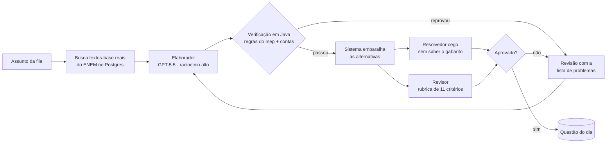

<h1 align="center">enem.daily</h1>

<p align="center">
  <b>Um desafio diário de 4 questões inéditas do ENEM, geradas e revisadas por IA,<br>com um campus universitário que evolui a cada acerto.</b>
</p>

<p align="center">
  
  
  
  
  
  
</p>

---

## O que é

Todo dia o estudante recebe **4 questões, uma de cada área do ENEM** (Linguagens, Ciências Humanas, Ciências da Natureza e Matemática). Cada questão tem texto-base, comando e 5 alternativas, no mesmo formato da prova, e é **inédita**: foi escrita por IA na noite anterior e passou por uma revisão automática antes de ir ao ar.

Acertou, ganha XP (mais rápido, mais XP), mantém a sequência de dias e **constrói uma peça do seu campus universitário**, uma cidade isométrica que cresce de um terreno vazio até uma universidade completa, com reitoria, área de lazer, hospital e praça de alimentação. Dá para competir em grupos com ranking, marcar duelos com amigos e compartilhar o resumo do dia.

<p align="center">
  
  
  
</p>
<p align="center">
  
  
  
</p>

> Este repositório é o **frontend** (Angular). O backend (Spring Boot) fica em um repositório separado; as partes dele que importam para entender o projeto estão descritas abaixo.

---

## A parte que mais me orgulha: a geração de questões com IA

Gerar uma questão "parecida com o ENEM" é fácil. Gerar uma questão **que um professor não conseguiria derrubar em recurso** é outra história. A primeira versão do projeto fazia uma chamada só e confiava no resultado, e os problemas apareciam todo dia: alternativas absurdas, conta errada em Matemática, resposta óbvia, a alternativa certa sempre a mais longa.

Então eu parei de tratar a IA como "a resposta" e passei a tratar como **um elaborador que precisa ser conferido**, do jeito que a banca do Inep trabalha: alguém escreve, outra pessoa resolve sem saber o gabarito, um revisor avalia e o item volta para correção quando precisa. Em cima disso, tudo o que dá para conferir com código é conferido com código.



### 1. Modelo e esforço de raciocínio por etapa

Uso o **GPT-5.5 pela Responses API**, chamando a API direto com `java.net.http` (a biblioteca de IA que eu usava antes não expunha o controle de raciocínio). Cada etapa tem o seu nível de *reasoning effort*, configurável:

| Etapa | Esforço | Por quê |
|---|---|---|
| Elaborar a questão | `xhigh` | É onde nasce a qualidade: contas limpas, distratores que fazem sentido, texto-base que não é pretexto. |
| Resolver às cegas | `high` | Precisa achar dupla resposta e erro de conta, mas não precisa escrever nada longo. |
| Revisar | `medium` | Julga estilo e homogeneidade; a parte crítica já é coberta pelo Java e pelo resolvedor. |

Testei os níveis e medi: **uma questão aprovada de primeira custa cerca de US$ 0,40**. No nível baixo o custo empatava, porque o item reprovava e gerava mais rodadas de revisão. Barato que sai caro.

### 2. Saída estruturada com JSON Schema estrito

Nada de pedir "responda em JSON" e torcer. Cada etapa tem um **JSON Schema com `strict: true`** (Structured Outputs), então a resposta sempre chega no formato certo e eu converto direto para `record`s Java.

O detalhe de que mais gosto é **a ordem dos campos**. O modelo gera o JSON na ordem do schema, então eu uso essa ordem para guiar o raciocínio:

- **`verificacao_numerica` vem antes das alternativas.** O modelo se compromete com a conta antes de escrever as opções.
- **Em cada distrator, `hipotese_de_erro` vem antes do `texto`.** Primeiro ele decide *qual erro real* aquela alternativa representa ("esqueceu de converter minutos em horas") e só depois escreve a alternativa. Foi isso que acabou com as alternativas absurdas.
- O revisor lista os **problemas antes das notas** e as notas antes do veredito, para não dar a nota primeiro e justificar depois.

### 3. Prompt fixo + módulo dinâmico por área

O prompt do elaborador é dividido em duas partes:

- **Uma parte fixa**, escrita a partir do *Guia de Elaboração e Revisão de Itens* do Inep, com as regras organizadas em seções com tags (`<regras_do_texto_base>`, `<regras_das_alternativas>`, `<rigor>`…):
  - **o texto-base não pode ser pretexto:** escondendo o texto, deve ser impossível acertar;
  - **comando positivo:** proibido "exceto", "incorreta" e "não";
  - **distratores plausíveis**, sem pegadinha e sem "todas as anteriores";
  - **alternativas homogêneas**, sem o gabarito se destacar;
  - **honestidade nas fontes:** nunca inventar autor, livro ou dado.
- **Um módulo por área**, carregado conforme a questão. Ele traz a **Matriz de Referência oficial** (competências e habilidades H1 a H30), os objetos de conhecimento, como os itens daquela área costumam ser e os **distratores típicos**. Em Matemática, por exemplo: esquecer a conversão de unidade, confundir raio com diâmetro, aplicar a porcentagem sobre a base errada.

A parte fixa vem primeiro e é sempre igual, o que aproveita o **cache de prompt** da OpenAI (uso `prompt_cache_key` por etapa e por área).

### 4. Âncoras de estilo com questões reais (RAG simples)

Tenho no Postgres **2.193 questões oficiais do ENEM**. Antes de elaborar, busco por *full-text search* os textos-base de questões reais do mesmo assunto (ou da mesma área, se não houver) e coloco no prompt **como referência de gênero, tamanho e forma de citar fontes**, com a instrução explícita de não copiar nem reaproveitar o contexto. Também mando os últimos itens publicados naquela área, para o modelo não repetir a situação de ontem.

### 5. Um resolvedor que não sabe o gabarito

Depois de elaborado, o item vai para **outra chamada que resolve do zero**, sem o gabarito. Ela devolve a letra escolhida, a confiança e um julgamento de cada alternativa (correta, incorreta ou "defensável em recurso"), além de sinais como `mais_de_uma_defensavel`, `erro_conceitual_ou_de_calculo` e `texto_base_dispensavel`.

Se o resolvedor marca outra letra ou acha uma segunda alternativa defensável, a questão **não vai ao ar**: volta para revisão com o raciocínio dele anexado.

### 6. Um revisor com rubrica

Em paralelo, um revisor avalia o item completo, com gabarito, hipóteses de erro, resolução e alertas automáticos. Ele dá nota de 1 a 5 em 11 critérios (fidelidade ao ENEM, unicidade do gabarito, plausibilidade dos distratores, correção conceitual…) e lista cada problema com **gravidade, local e como corrigir**. Para aprovar, todas as notas precisam ser 4 ou 5 e não pode haver problema grave.

### 7. Revisão em loop, com feedback que o modelo entende

Quando algo falha, eu junto tudo num só retorno: os erros do Java, o raciocínio do resolvedor e os apontamentos do revisor. Um cuidado que fez diferença: o resolvedor e o revisor falam em letras ("a alternativa C também serve"), mas o elaborador nunca viu as letras, porque **quem embaralha é o sistema**. Então mando junto a ordem em que as alternativas foram apresentadas, para o feedback fazer sentido.

São no máximo 2 revisões por rascunho e 2 rascunhos. Se nada for aprovado sem ressalvas, publico a melhor versão que passou nas checagens de **correção**; erro de gabarito nunca passa.

### 8. O que dá para conferir com código, eu confiro com código

A IA não é a última palavra. Antes de qualquer avaliação por IA, o item passa por uma **verificação determinística em Java**:

- exatamente 5 alternativas e 1 correta, sem repetição;
- comando sem termos negativos;
- nenhuma menção a letra ("a alternativa C"), já que a ordem muda depois;
- gabarito não muito mais longo que os distratores (o truque clássico de quem chuta);
- texto-base com tamanho mínimo, sem referência a figuras que não existem e com tabela bem formada.

E principalmente: **as contas são refeitas**. O elaborador entrega a expressão do cálculo (`150 * 0.8 * 1.1`) e um **avaliador de expressões que eu escrevi** (parser recursivo, sem `eval`) recalcula e compara com o valor do gabarito. Se não bater, o item volta. Foi isso que resolveu os erros de conta em Matemática.

### 9. A ordem das alternativas é decisão do sistema, não da IA

Modelos têm vícios de posição. Por isso o sistema monta a ordem final: alternativas **numéricas em ordem crescente**, como o Inep recomenda, e as textuais embaralhadas com o gabarito indo para a **letra menos usada nas últimas questões**, para não criar padrão.

### 10. Robustez de produção

- **Modo background da Responses API, com polling:** chamadas de raciocínio longo não dependem de uma conexão HTTP aberta por minutos.
- **Retentativas com backoff** em 429/5xx, respeitando o `retry-after`, e limite de tempo por chamada.
- **Custo de cada chamada no log** (tokens de entrada, cache, saída e raciocínio) e **status da geração em tempo real** no painel de admin.
- **Sanitização do HTML** que a IA devolve, com lista de tags permitidas, antes de chegar na tela.
- **Geração agendada às 20h** para o dia seguinte, com uma **repescagem às 00h05** para as áreas que falharam.

### Também usei IA para conteúdo, com revisão humana

Cada assunto do ENEM pode ganhar uma **página de estudo para SEO**: resumo, "como cai no ENEM" (com as habilidades da Matriz) e "para não errar". O rascunho sai do mesmo pipeline, com prompt próprio e schema estrito, por cerca de US$ 0,10. Mas nada vai ao ar sem eu revisar e publicar pelo editor do admin, que tem pré-visualização e prévia de como a página aparece no Google.

<p align="center">
  
</p>

---

## Regras de negócio no lugar certo

Uma decisão que eu fiz questão de corrigir: **o gabarito não sai do servidor antes da resposta.** A questão chega ao app sem a alternativa correta, sem análise e sem resolução. O app manda só a alternativa marcada e o tempo gasto; quem corrige e calcula o XP (com o bônus de sequência) é o backend, que também impede responder duas vezes a mesma área no dia. Depois de respondida, a questão pode ser reaberta já corrigida, com a resposta que a pessoa marcou.

---

## Backend (Spring Boot)

- **Java 21, Spring Boot 3.5, Spring Data JPA, PostgreSQL** e autenticação com **JWT**.
- **Cliente da OpenAI próprio** (Responses API, Structured Outputs, background mode, retentativas), sem depender de SDK.
- **Web Push implementado na mão**, com a criptografia do próprio JDK: cifragem `aes128gcm` (RFC 8291) e assinatura **VAPID** ES256 (RFC 8292). Há lembretes às 10h e às 20h, este citando a sequência de dias ("Não perca a sua sequência de 12 dias").
- **Comunidade:** amizades, bloqueios e duelos diários com placar ao vivo.
- **Painel de admin:**
  - números do dia e calendário de atividade;
  - busca de usuários e **exclusão em cascata** em transação única, inclusive as fotos no Firebase;
  - gestão dos assuntos da fila de geração;
  - botão para gerar as questões do dia.
- **Configurações da conta:** troca de nome de usuário com checagem de disponibilidade, e-mail e senha, com as regras validadas no servidor.

<p align="center">
  
</p>

## Frontend (este repositório)

- **Angular 19** com componentes *standalone*, control flow novo (`@if`, `@for`, `@defer`) e design system próprio em tokens CSS, com tema claro e escuro.
- **Motor isométrico do campus em SVG, feito do zero:**
  - mais de 400 peças entre prédios, andares, terrenos e acabamentos;
  - versão de dia e de noite;
  - animação de construção e câmera que vai até a obra nova;
  - estruturas especiais liberadas por metas (acertos, dias ativos, XP).
- **PWA instalável:** abertura animada só no app instalado, aviso de nova versão e notificações push.
- **Sons gerados pela Web Audio API**, sem nenhum arquivo de áudio: a caneta marcando a bolha, o "pop" da construção, uma nota por bolinha no resumo do dia, o fogo da sequência. Tudo pode ser desligado no menu.
- **Resumo do dia compartilhável:** a imagem é desenhada em `canvas` e enviada pelo menu de compartilhar do celular.
- **Desempenho:** rotas carregadas sob demanda e landing só para visitantes. O carregamento inicial caiu de **1,86 MB para 1,19 MB**.
- **SEO sem reescrever o app para SSR:** um script roda no build da Vercel e gera o HTML pronto de cada página de conteúdo, mais o `sitemap.xml` e o `robots.txt`. O Google lê o texto completo, e o Angular assume em seguida. Publicar um conteúdo no admin dispara um novo deploy por *deploy hook*.

---

## Rodando localmente

```bash
npm install
npx ng serve
```

O app abre em `http://localhost:4200` e espera o backend em `http://localhost:8080`.

Para o build de produção com as páginas de conteúdo pré-renderizadas:

```bash
API_URL=https://sua-api SITE_URL=https://seu-site npm run build:vercel
```

---

<p align="center">
  Feito por <a href="https://github.com/joaopedro1422">João Pedro</a>, do design do campus ao pipeline de IA.
</p>
